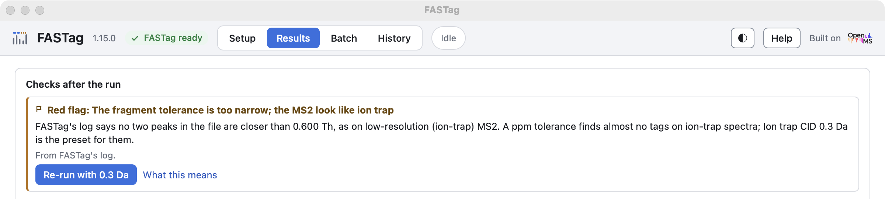
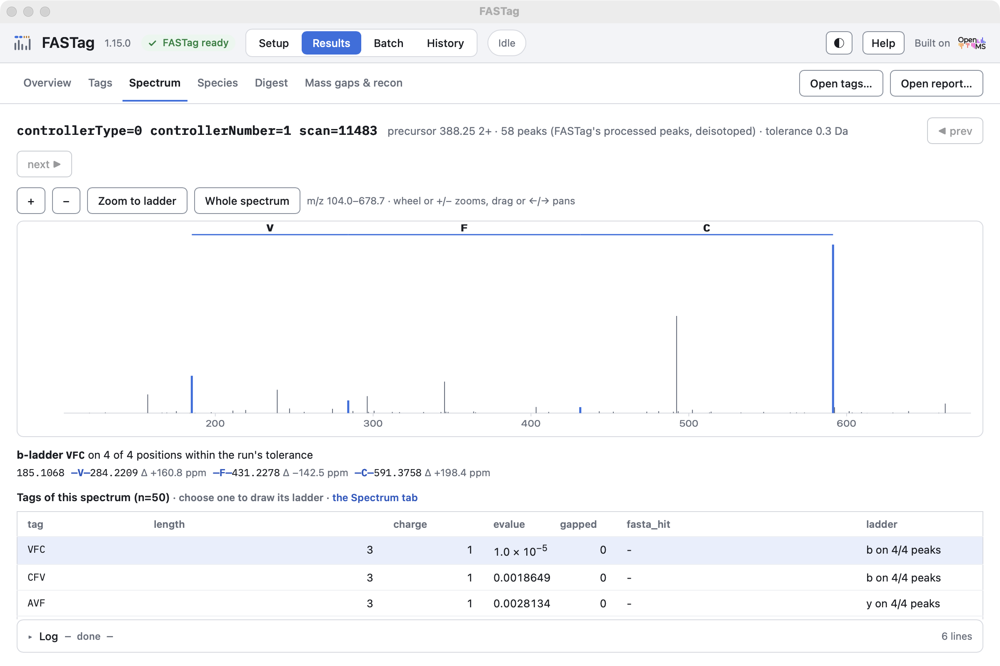
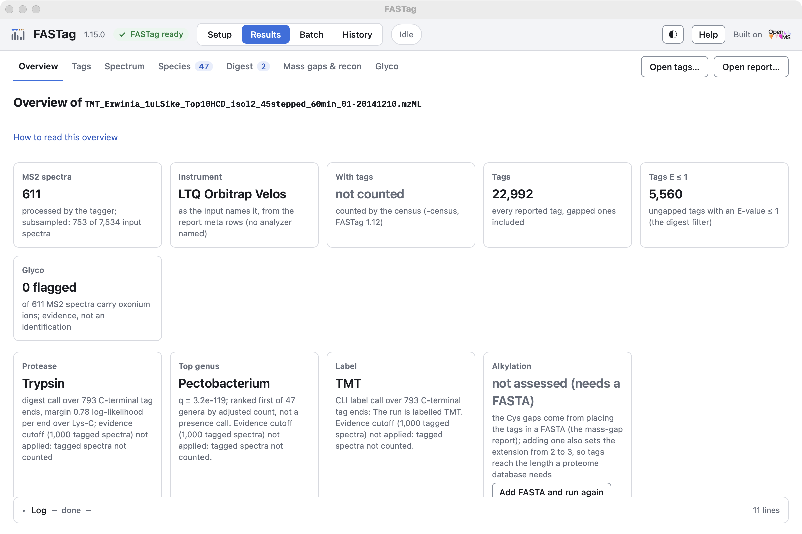
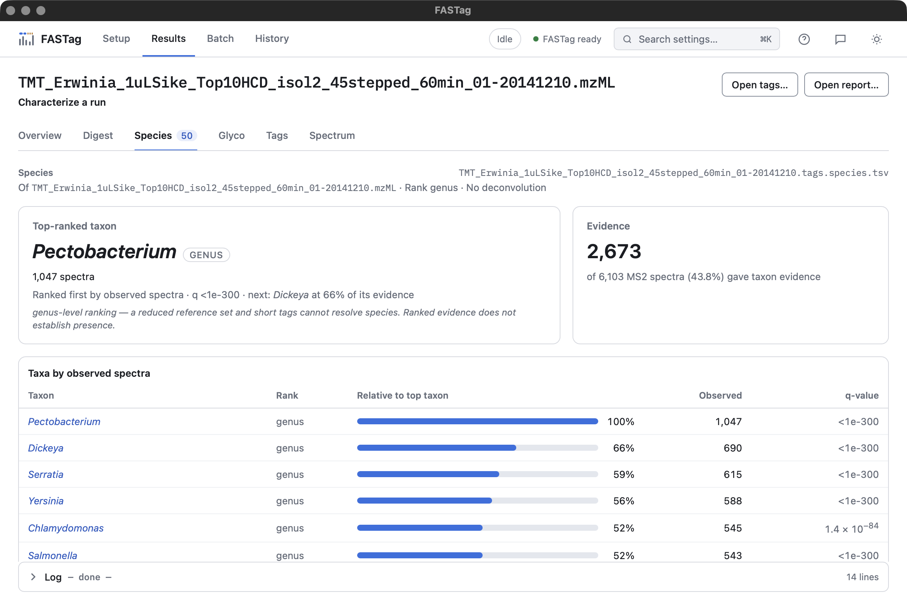
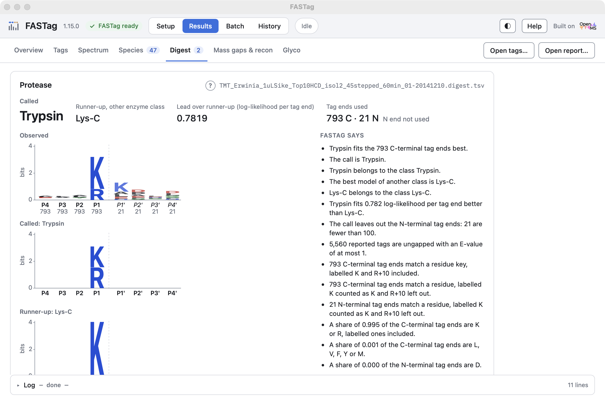

# FASTag desktop app: user manual

The desktop app runs the FASTag command-line tool for you and shows its results: tags, spectra,
species, digestion and labels. Everything it does can also be done on the command line
([TUTORIAL.md](TUTORIAL.md)); **Export INI…** and **Copy command line** give the exact command.
Screenshots are from FASTag 1.15 on macOS; Windows and Linux look the same apart from the
window frame.

Install: see the [README](../README.md#install) (macOS disk image or Homebrew cask, Windows
installer, Linux `.deb`, tarball or AppImage).

## 1. A first run on the example data

**File > Open Example Data** copies the example run that ships with the app
([examples/](../examples/README.md): 139 MS2 spectra of an *E. coli* digest) to a folder you can
write to and selects it as input. Any mzML, mzPeak or MGF file works the same way through
**Choose file…** or by dropping it on the window.

1. **What do you want to do?** Keep **Generate tags**: tags for all spectra. The other tasks open
   earlier results, survey a run (species, digestion, labels) or check a batch against an SDRF file.
2. **Checks before the run** reads the file's metadata. Here the instrument is an LTQ Orbitrap XL,
   which can read MS2 in either analyser; the file does not say which, so the app does not guess and
   warns that the MS2 may be ion-trap.
3. **Fragment tolerance preset** must match the analyser that read the MS2: about 20 ppm for
   Orbitrap, Astral or TOF MS2, 0.3 Da for ion-trap MS2. This file is ion-trap MS2: choose
   **Ion trap CID 0.3 Da**.
4. **Output**: by default the tags TSV is written beside the input.
5. Click **Run on Ecoli_MS2_small.mzML**.

If the tolerance was wrong, **Checks after the run** says so from the peak spacing it saw and offers
a re-run with the right setting:

## 2. Tags

**Results > Tags** lists every tag: the spectrum, the residues read (`tag`), the unexplained mass
on each side (`nterm_mass`, `cterm_mass`), the E-value (smaller is better) and, with a FASTA, where
it occurs. Filter by text, length, E-value or database hit; **Export shown rows…** saves what is
shown.

With a FASTA, the CLI option `-fasta_proteins <n>` (which the GUI sets to 3) also writes which
proteins the tag occurs in and where: `db_proteins` lists up to n of them as
`identifier@start-end` (1-based positions in the protein), `db_genes` their gene names (`GN=` in
the FASTA header, `-` when there is none) and `db_protein_count` how many proteins hold the tag in
all. Only matches in the orientation `fasta_hit` names count, target proteins come before decoys,
and entrapment matches name proteins of the entrapment database. A protein is named by its
identifier only, so give each entry its own: when entries repeat an identifier the run warns, and
the Spectrum tab names such a protein with the positions but does not align the tags on it.

Select a row and press Enter (or **Open in Spectrum**) to see its evidence:

The stick plot shows the peaks FASTag used; the tag's b and y ladders are drawn over them on
their own lines, each labelled with its series as judged from the peaks (**b or y?** when it is not
told apart), with the mass error of each step, and the table below lists the spectrum's other tags.

## 3. Surveying a run

**Characterize a run** samples 10% of the spectra and adds the species, digest, label and glyco
reports. The screenshots use PXD000001 (an *Erwinia carotovora* lysate, trypsin, TMT; see
[TUTORIAL.md, Part 2](TUTORIAL.md#part-2-pxd000001) for the download).

The **Alkylation report** (step 4, off by default) needs no protein database and no shipped
proteome: it reads the cysteine forms in the tags. Its votes need a cysteine inside a tag, so a
larger Extension gives more; on 10% of the spectra at Extension 2 it often says "no call" with the
counts. On all of PXD000001 at Extension 2 it calls Methylthio (MMTS), 52 of 69 votes.

**Results > Overview** summarises the reports on one page:

**Species** ranks taxa by the spectra whose tags occur in their proteomes. The top genus here,
*Pectobacterium*, is the current genus of *Erwinia carotovora*. A ranking is evidence, not a
presence call: short tags cannot resolve close species, and "no call" does not mean absent.

**Digest** shows which protease the tag ends fit best, as sequence logos around the cut, with
the runner-up model and FASTag's reasoning:

**Run QC** (`-qc_out`) names the isobaric kit of a labelled run (`reporter_kit`): the label
mass on the tag ends decides TMT (229.163 Da) or TMTpro (304.207 Da), and the kit is the
smallest one of that label that holds every reporter channel seen, so the PXD000001 run is
`tmt6plex` (the original TMT 6-plex reagent, with 127C and 129C; the current one has 127N and
129N, and both count as TMT 6-plex). Larger kits whose extra channels were not seen are not
listed. When the label mass cannot decide (a Da fragment tolerance, too few tags),
`reporter_kit_candidates` lists the smallest kit per label, for example `tmt10plex,tmt16plex`,
marked `reporters_only`. When the label mass and the channels disagree (a TMT label, but a
channel only TMTpro has), no kit is called: `reporter_kit` is `conflict`,
`reporter_family_evidence` is `label_conflict`, and the report names both the label and the
kits the channels allow.
`reporter_channel_<label>` counts the MS/MS spectra with each reporter above the noise
threshold (3x the spectrum's median peak), out of the spectra that can show it.

**Identifiability triage** writes one row per MS/MS spectrum (the census). Besides the best tag it
gives `max_len`, the longest tag of the spectrum, and `res_cover`, how many residues of the
peptide the spectrum's tags cover together. A tag read on b ions is placed by its orientation
when the `-fasta` match tells it; otherwise the tags are folded so that a stretch read on b and
on y ions counts once, and `res_cover` is a lower bound (`res_cover_exact` 0). The run summary
gives `max_tags`, the cap on the tags per spectrum.

## 4. Getting help

**Help** (F1) opens a searchable guide beside the results: a getting-started page, every tab,
every setting and every error message, and a glossary.

**History** keeps every run with its exact command line, so a result can be reopened or re-run.
Questions and bugs: [GitHub issues](https://github.com/okohlbacher/FASTag/issues).
