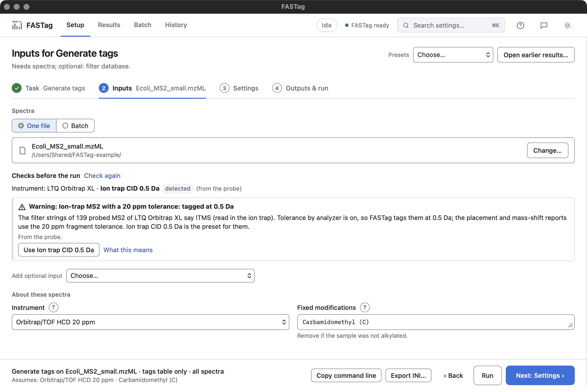
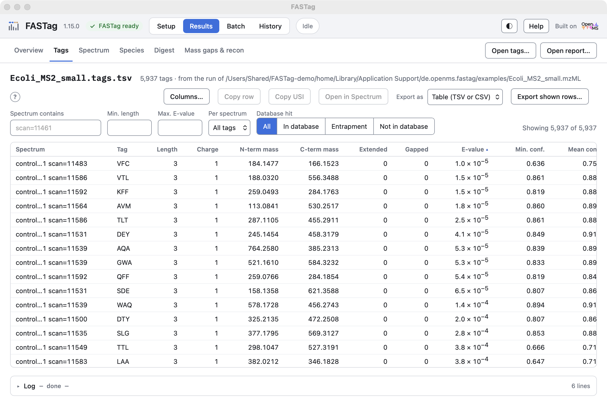
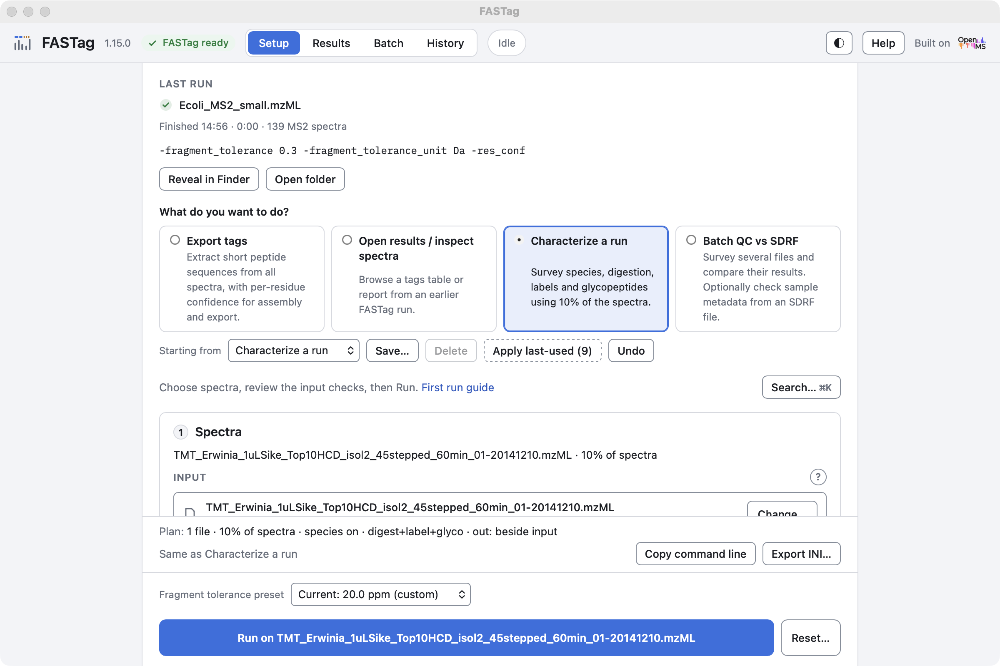
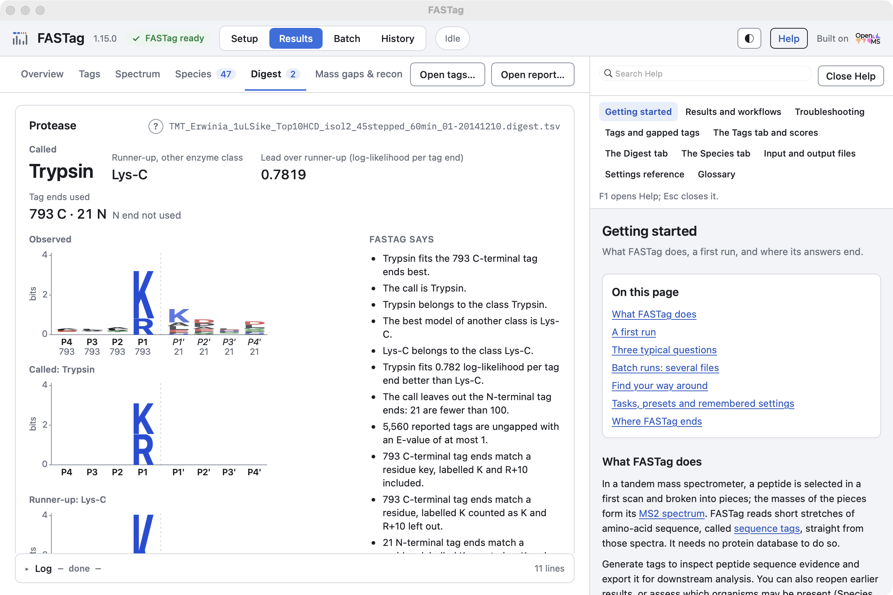

# FASTag desktop app: user manual

The desktop app runs the FASTag command-line tool for you and shows its results: tags, spectra,
species, digestion and labels. Everything it does can also be done on the command line
([TUTORIAL.md](TUTORIAL.md)); **Export INI…** and **Copy command line** give the exact command.
Screenshots are from FASTag 1.15 on macOS; Windows and Linux look the same apart from the
window frame.

Install: see the [README](../README.md#install) (macOS disk image or Homebrew cask, Windows
installer, Linux `.deb`, tarball or AppImage).

## 1. A first run on the example data

**File > Open Example Data** copies the example run that ships with the app
([examples/](../examples/README.md): 139 MS2 spectra of an *E. coli* digest) to a folder you can
write to and selects it as input. Any mzML, mzPeak or MGF file works the same way through
**Choose file…** or by dropping it on the window.

1. **What do you want to do?** Keep **Generate tags**: tags for all spectra. The other tasks open
   earlier results, survey a run (species, digestion, labels) or check a batch against an SDRF file.
2. **Checks before the run** reads the file's metadata. Here the instrument is an LTQ Orbitrap XL,
   which can read MS2 in either analyser; the file does not say which, so the app does not guess and
   warns that the MS2 may be ion-trap.
3. **Fragment tolerance preset** must match the analyser that read the MS2: about 20 ppm for
   Orbitrap, Astral or TOF MS2, 0.3 Da for ion-trap MS2. This file is ion-trap MS2: choose
   **Ion trap CID 0.3 Da**.
4. **Output**: by default the tags TSV is written beside the input.
5. Click **Run on Ecoli_MS2_small.mzML**.

If the tolerance was wrong, **Checks after the run** says so from the peak spacing it saw and offers
a re-run with the right setting:

## 2. Tags

**Results > Tags** lists every tag: the spectrum, the residues read (`tag`), the unexplained mass
on each side (`nterm_mass`, `cterm_mass`), the E-value (smaller is better) and, with a FASTA, where
it occurs. Filter by text, length, E-value or database hit; **Export shown rows…** saves what is
shown.

Select a row and press Enter (or **Open in Spectrum**) to see its evidence:

The stick plot shows the peaks FASTag used; the tag's b or y ladder is drawn over them with the
mass error of each step, and the table below lists the spectrum's other tags.

## 3. Surveying a run

**Characterize a run** samples 10% of the spectra and adds the species, digest, label and glyco
reports. The screenshots use PXD000001 (an *Erwinia carotovora* lysate, trypsin, TMT; see
[TUTORIAL.md, Part 2](TUTORIAL.md#part-2-pxd000001) for the download).

**Results > Overview** summarises the reports on one page:

**Species** ranks taxa by the spectra whose tags occur in their proteomes. The top genus here,
*Pectobacterium*, is the current genus of *Erwinia carotovora*. A ranking is evidence, not a
presence call: short tags cannot resolve close species, and "no call" does not mean absent.

**Digest** shows which protease the tag ends fit best, as sequence logos around the cut, with
the runner-up model and FASTag's reasoning:

## 4. Getting help

**Help** (F1) opens a searchable guide beside the results: a getting-started page, every tab,
every setting and every error message, and a glossary.

**History** keeps every run with its exact command line, so a result can be reopened or re-run.
Questions and bugs: [GitHub issues](https://github.com/okohlbacher/FASTag/issues).
